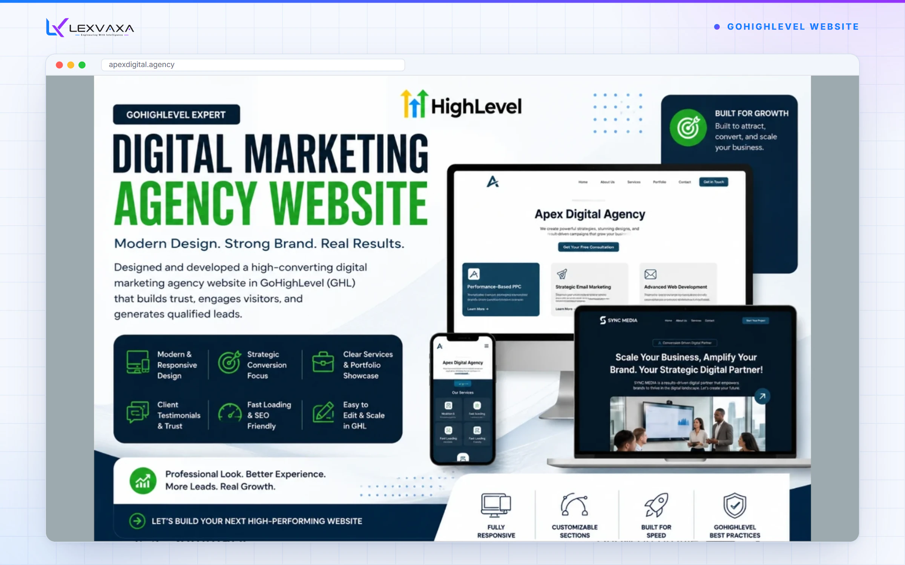

<!-- styled:v2 -->

**A conversion-focused agency website in GoHighLevel that explains the services clearly and is built to turn visitors into leads.**

  
  
  
  
  
  

  <a href="#overview">Overview</a> ·
  <a href="#key-features">Key features</a> ·
  <a href="#results">Results</a> ·
  <a href="#tech-stack">Tech stack</a>

---

## Overview

A digital marketing agency needed a professional online presence that clearly explains its services and supports lead generation. Lexvaxa designed and developed a responsive website in GoHighLevel with service and portfolio pages, testimonials and trust sections, a lead-focused page structure with clear calls to action and a flexible layout the team can update easily. Screens shown use sample data, so no client records are exposed.

## The challenge

The agency needed a site that looked credible, explained its services simply and actually produced leads.

## The solution

A responsive GoHighLevel website with a lead-focused structure, trust sections and forms connected to the agency CRM.

## Key features

- Service and portfolio pages
- Testimonials and trust sections
- Lead-focused page structure and calls to action
- Responsive on desktop, tablet and mobile
- Flexible, easy-to-update layout

## Results

- A scalable website structure that supports the agency's growth

## Tech stack

   

## Privacy

Client names and records are confidential. Every screen in this repository uses sample data, and source code that belongs to the client is not published.

## Links

- Case study on Lexvaxa: https://lexvaxa.com/work/ghl-digital-marketing-agency-website

---

**Built by [Ch Muhammad Samiullah](https://github.com/samiullah156-creator)** · AI Automation Engineer and Full-Stack Developer at [Lexvaxa](https://lexvaxa.com)

⭐ Star this repo if you found it useful

